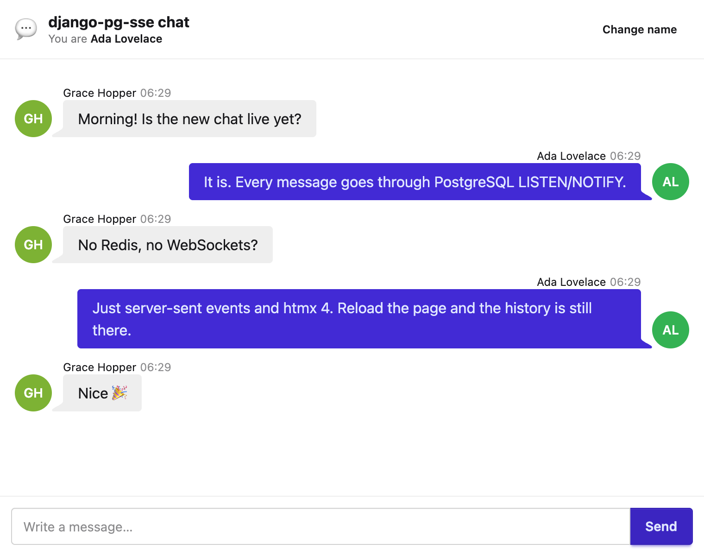

# django-pg-sse demo

A small chat that shows [django-pg-sse](https://github.com/oliverandrich/django-pg-sse) in a Django project.
Visitors pick a name and chat; there is no login.
Messages reach every open browser over PostgreSQL LISTEN/NOTIFY and server-sent events.
No Redis and no WebSocket server are involved.



The project was generated from [django-project-starter](https://github.com/oliverandrich/django-project-starter).
It uses htmx 4 with its hx-sse extension, and Tailwind CSS with daisyUI.

## Run it

You need [mise](https://mise.jdx.dev/) and a running PostgreSQL server.

```sh
mise trust
mise run bootstrap   # .env, dependencies, database, CSS
mise run migrate
mise run debugserver
```

Open <http://127.0.0.1:8000/> in two browsers, or in a normal and a private window.
`mise run runserver` speaks WSGI and cannot stream, so use `debugserver`.

## Where to look

| File | What it shows |
|---|---|
| `demo/views.py` | `send()` stores a message and calls `broadcast("public:chat", html)`. |
| `demo/templates/chat.html` | The partial `broadcast` wraps a message in `hx-swap-oob="beforeend"` for `#messages`. |
| `demo/templates/chat.html` | `hx-sse:connect` opens one stream for the topic `public:chat`. |
| `demo/templates/chat.html` | A short script aligns the visitor's own messages, since every visitor receives the same HTML. |
| `demo/settings.py` | `PG_SSE` points `CAN_SUBSCRIBE` at `demo/events.py`. |
| `demo/urls.py` | The stream view lives at `/events/`. |

`broadcast()` sends after the transaction commits.
The default `can_subscribe()` opens `public:` topics to everyone, so anonymous visitors may read the chat.
A reconnecting browser replays the messages it missed from the table `django_pg_sse_streamevent`.
The page itself renders the last 50 messages.

## Known limits

A message sent between rendering the page and opening the stream does not reach that page.
The first connect has no `Last-Event-ID` to replay from.

## License

MIT, see [LICENSE](LICENSE).
